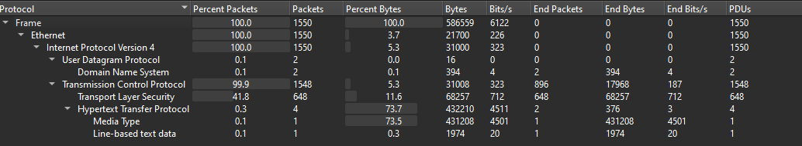
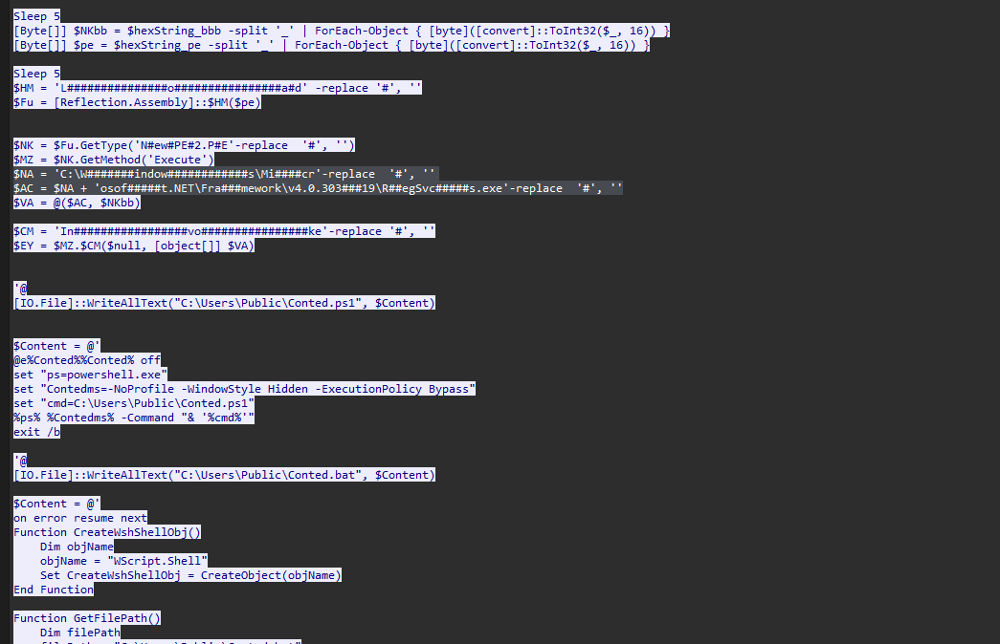
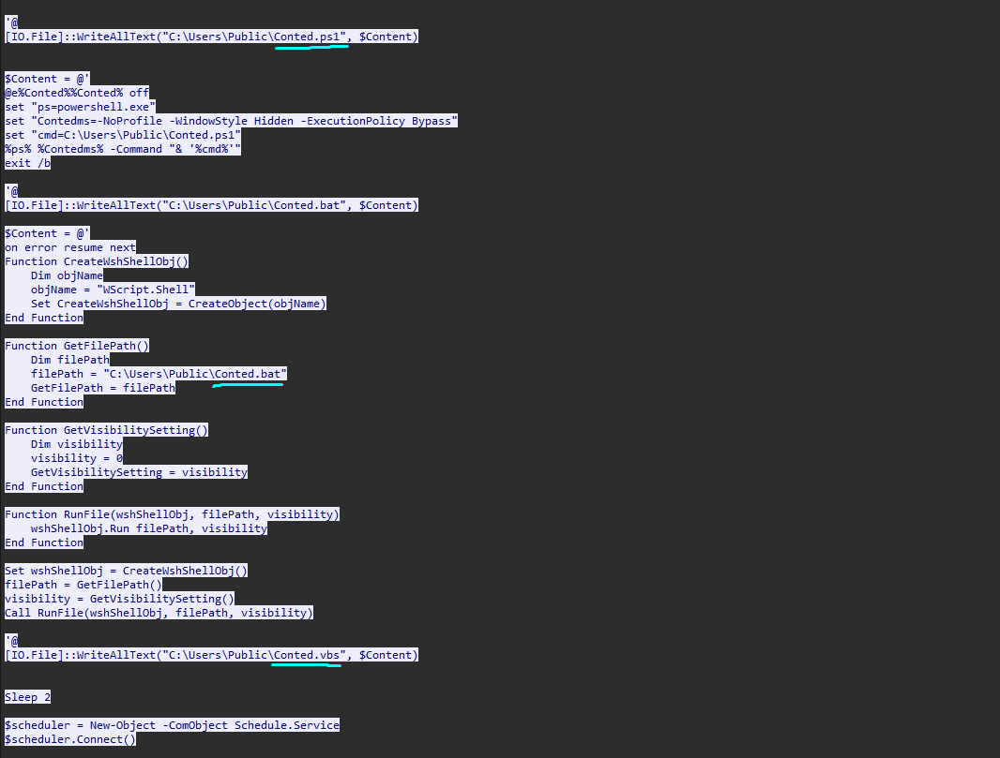

### 1. The attacker successfully executed a command to download the first stage of the malware. What is the URL from which the first malware stage was installed?

Первым делом я открыл `.pcap` файл и перешёл в `Statistics → Protocol` Hierarchy для первичного  анализа.

По иерархии протоколов видно, что HTTP имеет минимальное кол-во пакетов, всего 4, но на этот протокол приходится 73.7% всех переданных байтов. Это говорит о том, что по нему передавался крупный файл, а так как HTTP не зашифрован, я могу легко посмотреть его содержимое. Дальше логичнее всего будет применить фильтр `http` и открыть `Follow → HTTP Stream`, чтобы вытащить точные `Host` и `URI` из которых собирается полный URL.

Видно 2 последовательных GET-запроса к внешнему узлу `45.126.209.4` сначала запрашивается текстовый файл `/xlm.txt`, а через секунду изображение `/mdm.jpg`.

Я открыл `Follow → HTTP Stream` для первого запроса (`GET /xlm.txt`), чтобы посмотреть содержимое скачанного файла. В ответе сервера оказался обфусцированный VBScript: он собирает единую строку из массива подстрок `LZeWX` и через `WScript.Shell` запускает скрытый процесс PowerShell (`-WIND HIDDeN -eXeC BYPASS`).

Расшифровав получилось значение `http://45.126.209.4:222/mdm.jpg`, это и есть ответ на вопрос.

### 2. Which hosting provider owns the associated IP address?

Чтобы проверить какому хостинг-провайдеру принадлежит этот IP-адрес я ввёл его через VirusTotal

IP-адрес принадлежит хостинг-провайдеру **ReliableSite.Net LLC** (также видно, что адрес уже имеет плохую репутацию 14 из 92 вендоров помечают его как вредоносный)

### 3. By analyzing the malicious scripts, two payloads were identified: a loader and a secondary executable. What is the SHA256 of the malware executable?

Я открыл `Follow → HTTP Stream` для второго запроса (`GET /mdm.jpg`). Несмотря на расширение изображения и заголовок `Content-Type: image/jpeg`, внутри тела ответа оказался PowerShell-скрипт, содержащий два больших шестнадцатеричных блока данных: `$hexString_bbb` и `$hexString_pe`. Оба начинаются с байтов `4D 5A 90 00` это сигнатура заголовка `MZ` исполняемого файла Windows PE.

Чтобы определить, какой из них является целевой полезной нагрузкой, а какой загрузчиком, я проанализировал код ниже в этом же скрипте:

- Переменная `$pe` (из `$hexString_pe`) загружается в память процесса через `[Reflection.Assembly]::Load($pe)` и предоставляет метод `NewPE2.PE.Execute`. Это .NET-инжектор (загрузчик).
- Переменная `$NKbb` (из `$hexString_bbb`) передается в этот метод как аргумент вместе с путем к легитимному процессу `RegSvcs.exe` для внедрения в память . Следовательно, именно `$hexString_bbb` является искомым вредоносным исполняемым файлом.

Я перенес содержимое `$hexString_bbb` в **CyberChef** и применил цепочку операций:

1. **Find / Replace**: удалил символы `_`, чтобы получить непрерывную шестнадцатеричную строку.
2. **From Hex**: преобразовал текст обратно в сырой бинарный поток (восстановил оригинальный PE-файл).
3. **SHA2 (Size: 256)**: вычислил криптографический хеш от восстановленного бинарника.

**Результат:** 1eb7b02e18f67420f42b1d94e74f3b6289d92672a0fb1786c30c03d68e81d798

### 4. What is the malware family label based on Alibaba?

Проверяю хэш SHA256 в VirusTotal, показывает, что 61/71 вендоров помечают хэш вредоносным.  

**Ответ:** AsyncRat

### 5. What is the PE header compile (Creation Time) timestamp of the malware?

В VirusTotal во вкладке Details в разделе Creation Time отображается время создания:

**Ответ:** 2023-10-30 15:08

### 6. Which LOLBin is leveraged for stealthy process execution in this script? Provide the full path.

Пролистывая содержимое файла mdm.jpg, я обнаружил второй этап PowerShell. Скрипт обфусцирован с помощью символов "`#`".

Чтобы сделать код читаемым, я скопировал этот фрагмент в CyberChef и удалил все символы "`#`" с помощью операции Find / Replace. После деобфускации стало видно, что путь "`C:\Windows\Microsoft.NET\Framework\v4.0.30319\RegSvcs.exe`" передается в метод инъекции `NewPE2.PE.Execute` в качестве легитимного процесса для внедрения вредоносной нагрузки (.NET, MITRE ATT&CK **T1218.009**).

### 7. The script is designed to drop several files. List the names of the files dropped by the script.

